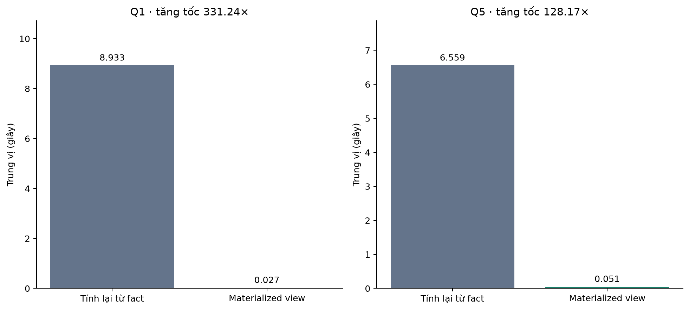

# Phân tích dữ liệu sách và tối ưu hiệu năng xử lý

Repository: [npmt2022005/book-sales-bigdata](https://github.com/npmt2022005/book-sales-bigdata).

Đề tài học phần **Nhập môn Khoa học dữ liệu**: xây dựng bộ dữ liệu về kinh doanh sách và thực nghiệm các phương pháp tối ưu khi dữ liệu tăng lớn.

Project xử lý **20.342.188 lượt đánh giá đã xác minh mua hàng** từ Amazon Reviews 2023 – Books; tổ chức warehouse, phân tích khám phá, tính RFM, phân cụm người dùng và đo hiệu năng qua **hai đợt Colab độc lập với 1.120 lượt đo chính**. Dashboard Streamlit cho phép xem dữ liệu và kết quả mà không cần tải nguồn thô.

> Đơn vị quan sát là **lượt đánh giá**, không phải đơn hàng. Các cột mang tên `sales`, `purchase`, `revenue` là tên kỹ thuật lịch sử. Giá trị tiền tính theo metadata chỉ là đại diện, không phải doanh thu hoặc chi tiêu thực.

## Nhóm thực hiện

| Thành viên | Mã sinh viên |
|---|---|
| Nguyễn Phạm Minh Thức | N23DCCN129 |
| Nguyễn Thành Nam | N23DCCN108 |

**Giảng viên hướng dẫn:** ThS. Nguyễn Ngọc Duy — Học viện Công nghệ Bưu chính Viễn thông.

## Xem nhanh sản phẩm

- [Báo cáo PDF](reports/submission/Bao_cao_kinh_doanh_sach.pdf) · [Bản Word](reports/submission/Bao_cao_kinh_doanh_sach.docx).
- [Từ điển dữ liệu](docs/DATA_DICTIONARY.md): 7 bộ dữ liệu, 58 cột.
- [Hướng dẫn kiểm thử](docs/TESTING.md) · [Thiết kế thực nghiệm bổ sung](docs/POSTGRES_EXTENDED.md).
- [Notebook thực nghiệm cơ bản](notebooks/benchmark_4sizes.ipynb).
- [Notebook work_mem và materialized view](notebooks/benchmark_postgres_extended.ipynb).
- [Dữ liệu và cách tái lập](docs/DATA_ACCESS.md) · [Hướng dẫn dashboard](dashboard/README.md).



## Những phần đã triển khai

| Hạng mục | Sản phẩm |
|---|---|
| Thu thập, làm sạch | JSONL → Parquet; khảo sát thiếu/trùng; chuẩn hóa giá; lọc đánh giá xác minh |
| Warehouse | `fact_sales`, `dim_books`, `dim_customers`, `dim_date`; bổ sung tồn kho mô phỏng |
| Hiệu năng cơ bản | CSV đầy đủ, CSV chọn cột, Parquet, DuckDB, PostgreSQL trước/sau B-tree |
| PostgreSQL bổ sung | `work_mem` 4/32/64 MB; materialized view cho Q1 và Q5 |
| EDA | 8 biểu đồ và 11 bảng thống kê |
| RFM/K-Means | RFM toàn bộ người dùng; mẫu phân tầng 150.000 người; k = 2–5, 3 seed |
| Chất lượng | 13 test project khi có đủ artifacts; 37 kiểm tra toàn dữ liệu; 6 test dashboard |
| Giao diện | 4 trang Streamlit + DuckDB; lựa chọn hai đợt thực nghiệm |

Polars, BRIN, phân vùng, Redis, phân trang và đo ghi đồng thời **chưa triển khai**. Không trình bày chúng như kết quả đã có.

## Cài đặt và chạy dashboard

Môi trường chạy cục bộ đã kiểm tra: **Python 3.11, Windows**. Các notebook benchmark chạy riêng trên Colab CPU, Python 3.13; không so thời gian trực tiếp giữa máy cá nhân và Colab.

Sau khi clone/tải repository, mở terminal tại thư mục gốc project:

```powershell
python -m venv .venv
.venv\Scripts\python -m pip install -r requirements.txt
.venv\Scripts\python -m streamlit run dashboard\app.py --server.address 127.0.0.1 --server.port 8501
```

Mở **http://localhost:8501**. Dừng bằng `Ctrl+C` tại terminal chạy server. Trên Linux/macOS, thay `.venv\Scripts\python` bằng `.venv/bin/python`.

**Không cần PostgreSQL hay nguồn 35 GB để xem dashboard.** Repository chứa `dashboard/data` đã tổng hợp: cube đánh giá, top sách, hồ sơ cụm, kết quả benchmark và kiểm tra đã lưu. DuckDB chỉ truy vấn các tệp nhỏ này; không quét lại 20 triệu dòng mỗi lần đổi bộ lọc. Đây là dữ liệu snapshot, không cập nhật trực tiếp từ Amazon.

| Trang | Nội dung và bộ lọc |
|---|---|
| Hiệu năng | Chọn đợt 720/400 lượt, quy mô, Q1–Q6; xem trung vị, IQR, tăng tốc và chi phí view |
| Tổng quan | Quy mô, thời gian quan sát, điểm trung bình và kiểm tra chất lượng đã lưu |
| Khám phá sách | Lọc danh mục/năm cho chuỗi thời gian và điểm; bảng top sách dùng toàn kỳ và được ghi rõ |
| RFM & phân cụm | Quy mô cụm, nhóm thiếu giá, hồ sơ RFM, silhouette và lựa chọn k |

Dashboard chạy cục bộ, chưa có public hosting, phân quyền hoặc kiểm thử tải nhiều người.

## Dữ liệu và lược đồ

Nguồn: [McAuley Lab — Amazon Reviews 2023](https://huggingface.co/datasets/McAuley-Lab/Amazon-Reviews-2023), nhóm **Books**, gồm review và metadata. Tên “2023” là phiên bản bộ dữ liệu; tập sạch của project có ngày đánh giá từ **12/02/1997 đến 14/09/2023**.

| Bước lọc review | Số dòng |
|---|---:|
| Nguồn Books | 29.475.453 |
| Đã xác minh mua hàng | 20.566.389 |
| Sau gộp trùng và nối danh mục | 20.342.188 |

| Bảng | Số dòng | Đơn vị và khóa |
|---|---:|---|
| `fact_sales` | 20.342.188 | Lượt đánh giá; `sale_id`, FK sách/người/ngày |
| `dim_books` | 4.448.181 | Sản phẩm metadata; `book_key`, `parent_asin` |
| `dim_customers` | 8.353.809 | Người đánh giá; `customer_key`, `user_id` |
| `dim_date` | 9.711 | Ngày lịch liên tục; `date_key` |
| `fact_inventory` | 4.347.336 | Sách × tháng; có lớp thông tin mô phỏng |

Quy tắc chính:

- Chỉ giữ review xác minh, có khóa hợp lệ, điểm 1–5 và thời gian trong phạm vi xử lý.
- Gộp trùng theo `(user_id, parent_asin, timestamp_ms)`.
- Giá hợp lệ khi `0 < price_usd <= 1000`; giá thiếu/ngoài ngưỡng thành `NULL`.
- `quantity = 1` là giả định; `estimated_revenue = quantity × price_usd`.
- Khoảng 19,57% lượt trong tập sạch không có giá hợp lệ; không tự điền bằng 0.
- `stock_quantity`, `unit_cost` là mô phỏng; `is_simulated = true`. `units_sold` suy từ số lượt đại diện, không phải lượng bán thực.

Nguồn JSONL, database PostgreSQL, warehouse và artifacts theo từng người dùng **không được commit**. Xem [DATA_ACCESS.md](docs/DATA_ACCESS.md) để tái tạo hoặc chuẩn bị chúng; không có link tải warehouse công khai được tự suy đoán.

## Thiết kế thực nghiệm

### Đợt cơ bản — 720 lượt

Phiên `optimized_4sizes_1109_111529`: **4 quy mô × 6 cấu hình × 6 truy vấn × 5 lần**.

Cấu hình: Pandas CSV đầy đủ; Pandas CSV chọn cột; Pandas Parquet chọn cột; DuckDB Parquet; PostgreSQL không index; PostgreSQL có B-tree `customer_key`.

### Đợt PostgreSQL bổ sung — 400 lượt

Phiên `pg_extended_1110_132250`: **4 quy mô × (3 mức work_mem × 6 truy vấn + 2 truy vấn view) × 5 lần**.

Giữ `max_parallel_workers_per_gather = 2`. Các mức `work_mem` là 4, 32 và 64 MB; view theo tháng/ngày được thử ở 4 MB cho Q1/Q5. Tạo view, `ANALYZE`, dung lượng và **40 lượt full refresh** được ghi riêng, không cộng vào 1.120 lượt đo chính.

| Mã | Tác vụ |
|---|---|
| Q1 | Tổng giá trị đại diện theo tháng |
| Q2 | Top 10 sản phẩm theo từng nhãn danh mục |
| Q3 | Lịch sử đánh giá của một người dùng |
| Q4 | Số người dùng phân biệt theo năm |
| Q5 | Trung bình trượt 7 ngày trên lịch đầy đủ |
| Q6 | Tổng hợp RFM đại diện |

**Không trộn baseline hai phiên.** Đợt cơ bản dùng Pandas CSV/PostgreSQL của chính đợt đó; đợt mới dùng `postgres_4mb` mới. Cùng tên cấu hình không có nghĩa cùng CPU/cache giữa hai phiên. Tổng 1.120 lượt không phải một cuộc đua mọi cấu hình trên một máy duy nhất.

Mỗi tổ hợp có warm-up, xáo thứ tự và 5 lượt chính, báo trung vị. Kết quả từng dòng được đối chiếu sau chuẩn hóa thứ tự, không xóa dòng trùng; số thực dùng dung sai. Thời gian gồm đọc/truy vấn và đưa kết quả về client; không tính import, ghi tệp và đối chiếu. Đợt mới tính cả kết nối và thiết lập phiên. Cache hệ điều hành không bị xóa; RSS client không bao gồm RAM PostgreSQL server.

## Kết quả chính trên 20.342.188 dòng

### Đợt cơ bản

| Truy vấn | Pandas CSV (s) | Pandas Parquet (s) | DuckDB (s) |
|---|---:|---:|---:|
| Q1 | 15,63 | 4,66 | 1,13 |
| Q2 | 25,62 | 8,11 | 8,44 |
| Q3 | 18,45 | 6,29 | 2,36 |
| Q4 | 20,68 | 10,75 | 5,97 |
| Q5 | 16,56 | 4,22 | 1,03 |
| Q6 | 23,08 | 13,35 | 10,08 |

Pandas Parquet nhanh hơn CSV đầy đủ khoảng **1,73–3,93 lần**; DuckDB khoảng **2,29–16,07 lần**. B-tree giúp Q3 khoảng **1,25 lần** so với baseline PostgreSQL cùng đợt, chưa cải thiện rõ mọi truy vấn.

### Đợt bổ sung

| Thử nghiệm | Baseline 4 MB mới (s) | Cấu hình mới (s) | Tăng tốc |
|---|---:|---:|---:|
| Q2, work_mem 64 MB | 41,839 | 37,105 | 1,13× |
| Q5, work_mem 32 MB | 6,559 | 5,120 | 1,28× |
| Q1, materialized view | 8,933 | 0,027 | 331,24× |
| Q5, materialized view | 6,559 | 0,051 | 128,17× |

Tăng `work_mem` không giúp tất cả truy vấn; một số chậm hơn và vẫn còn thao tác sắp xếp ra đĩa. Materialized view tăng tốc vì đọc kết quả đã lưu, đổi lại chi phí:

| View | Số dòng | Tạo (s) | Refresh trung vị (s) | Dung lượng |
|---|---:|---:|---:|---:|
| `mv_monthly` | 317 | 9,844 | 9,709 | 16 KiB |
| `mv_daily` | 9.487 | 6,080 | 4,848 | 512 KiB |

View có thể cũ khi nguồn đổi; phép thử refresh tính lại toàn bộ trên nguồn không đổi, chưa đo ghi đồng thời hoặc bảo trì gia tăng. Không diễn giải tăng tốc đọc view là tăng tốc tính lại toàn bộ fact.

Bảng gốc: [144 tổ hợp cơ bản](results/phan_tich_thuc_nghiem_colab/bang_ket_qua_144_cau_hinh.csv), [80 tổ hợp bổ sung](results/postgres_extended_colab/comparison_extended_verified.csv), [chi phí view](results/postgres_extended_colab/materialized_view_costs.csv), [kiểm chứng đợt mới](results/postgres_extended_colab/validation.json).

## EDA và phân cụm người dùng

- Tập sạch có **3.470.693 sản phẩm được đánh giá**, khác với toàn bộ 4.448.181 dòng danh mục.
- Điểm trung bình khoảng **4,48/5**; dữ liệu 2023 chỉ đến 14/09, không so tổng năm trực tiếp với năm đầy đủ.
- Tính RFM cho toàn bộ 8.353.809 người dùng; R neo **15/09/2023**, F là số đánh giá, M là giá trị tiền đại diện.
- Chỉ phân cụm **5.821.888 người đủ giá ở tất cả lượt**. Giữ riêng 2.531.921 người thiếu giá với `cluster = -1`, không ép vào mô hình bằng M=0.
- Mẫu phân tầng **150.000 người** theo F; `log1p` + `StandardScaler`; k=2–5; seed 42, 2026, 1109; `n_init=10`.
- Chọn **k=2**, silhouette trung bình khoảng **0,429** trên cùng 3.000 người, ARI trung bình giữa seed khoảng **0,998** trên mẫu huấn luyện.
- Gán cụm cho toàn bộ nhóm đủ giá theo batch 100.000 dòng. Kết quả là nhóm hành vi quan sát, không phải phân khúc lợi nhuận hay rời bỏ đã xác nhận.

[Hồ sơ cụm](results/rfm_kmeans/cluster_profiles.csv) · [So sánh k](results/rfm_kmeans/model_selection.csv) · [Kiểm tra seed](results/rfm_kmeans/seed_stability.csv).

## Chạy kiểm thử

### Bản clone GitHub, chưa có warehouse/mô hình đầy đủ

```powershell
.venv\Scripts\python run_tests.py --unit-only
.venv\Scripts\python -m unittest discover -s dashboard\tests -v
```

Nhóm đầu chạy fixture và kiểm tra bằng chứng tổng hợp. Test nạp lại mô hình được **skip có thông báo** nếu thiếu model/mẫu Parquet (cố ý không đưa vào Git). Với bản clone không có model: dự kiến **12 test đạt, 1 skip**; dashboard có **6 test**. GitHub Actions cấu hình chạy hai nhóm này, không tải 35 GB nguồn và không bật PostgreSQL.

### Khi đã chuẩn bị đủ warehouse và RFM

```powershell
.venv\Scripts\python run_tests.py
```

Kết quả thực tế trên bộ dữ liệu đầy đủ: **13 test project và 37 kiểm tra dữ liệu đạt**. Báo cáo lưu tại [results/tests/data_validation.json](results/tests/data_validation.json). Lệnh không tái tạo dữ liệu và không chạy lại benchmark. Các kiểm tra gồm khóa/FK, giá/điểm, tổng theo từng người, tồn kho mô phỏng, RFM và việc loại nhóm thiếu giá.

Kiểm thử PostgreSQL online chạy riêng khi server có sẵn:

```powershell
.venv\Scripts\python src\test_postgres_extended.py
```

## Tái lập đầy đủ

### 1. Chuẩn bị nguồn

Tải `Books.jsonl(.gz)` và `meta_Books.jsonl(.gz)` từ nguồn chính thức; xem [hướng dẫn dữ liệu](docs/DATA_ACCESS.md). Không lấy dashboard cube làm dữ liệu thay thế cho ETL.

```powershell
.venv\Scripts\python src\01_convert_to_parquet.py meta --input external\meta_Books.jsonl.gz
.venv\Scripts\python src\01_convert_to_parquet.py reviews --input external\Books.jsonl.gz
.venv\Scripts\python src\02_profile_data.py
.venv\Scripts\python src\03_build_star_schema.py
.venv\Scripts\python src\04_generate_inventory.py
```

Các bước tạo dữ liệu thường từ chối ghi đè nếu đã có kết quả. Kiểm tra đường dẫn và đầu ra trước khi sử dụng `--force`. Dung lượng nguồn giải nén khoảng 35 GB, cần thêm chỗ cho Parquet, database và tệp tạm.

### 2. EDA và RFM

```powershell
.venv\Scripts\python src\08_eda.py
.venv\Scripts\python src\09_rfm_kmeans.py
.venv\Scripts\python run_tests.py
```

RFM script từ chối chạy nếu `rfm_all_users.parquet` đã có để tránh ghi đè. Các số đếm kiểm tra trong project được cố định theo bộ dữ liệu này; nếu thay nguồn/mẫu cần điều chỉnh hợp đồng và kết quả mong đợi.

### 3. Đo trên Colab

Tải thư mục `book-sales-colab` lên My Drive với `manifest.json` và `warehouse/*.parquet`; dùng đúng tài khoản Drive khi mount. Các notebook trong `notebooks` nhúng mã và kiểm checksum, không tự tải nguồn thô từ Amazon.

1. Mở `benchmark_4sizes.ipynb`, runtime CPU, Run all để đo nhóm cơ bản.
2. Mở `benchmark_postgres_extended.ipynb` để đo bổ sung; notebook tự đo baseline 4 MB mới.
3. Kết quả được lưu về Drive sau từng quy mô. Không dựa vào chạy nền miễn phí để bảo đảm notebook hoàn thành.
4. Tải ZIP kết quả để kiểm chứng, lưu giữ cả mã phiên và dữ liệu từng lượt.

Script phân tích hiện nhận hai **cấu trúc phiên đã nộp**, không phải parser chung cho mọi tag mới:

```powershell
.venv\Scripts\python src\07_analyze_benchmark.py --archive external\results-20261109T144133Z-1-001.zip
.venv\Scripts\python src\14_analyze_postgres_extended.py --archive external\pg_extended_1110_132250-20261110T173019Z-1-001.zip
```

Nếu tái đo bằng tag khác, cần cập nhật ánh xạ mã phiên trong script phân tích; không đổi tên phiên để giả vờ đây là số liệu cũ. Báo cáo/CSV đã kiểm chứng được commit để người đọc không bắt buộc tái chạy Colab.

### 4. PostgreSQL trên máy cá nhân — tùy chọn

Dashboard không cần bước này. Helper `pg_local.py` dành cho Windows, mặc định PostgreSQL 18 tại `C:\Program Files\PostgreSQL\18\bin`, database riêng `book_sales`, cổng **55432**.

```powershell
# Chỉnh nếu vị trí PostgreSQL khác mặc định:
$env:BOOK_SALES_PG_BIN = 'C:\Program Files\PostgreSQL\18\bin'
.venv\Scripts\python src\pg_local.py init
.venv\Scripts\python src\pg_local.py start
.venv\Scripts\python src\13_benchmark_postgres_extended.py --sizes 1m --repeats 2 --tag local_check_01
.venv\Scripts\python src\pg_local.py stop
```

`init` đã khởi động server; sau khi init thành công, bỏ qua `start` lần đó. Những lần sau chỉ dùng `start`. Cấu hình kết nối có thể đặt qua `BOOK_SALES_PG_DSN`; không commit giá trị có mật khẩu. Colab dùng PostgreSQL 16.15 theo log thực nghiệm; không ghép thời gian Windows PostgreSQL 18 vào bảng so sánh Colab.

### 5. Sinh lại dashboard và báo cáo

```powershell
.venv\Scripts\python dashboard\prepare_data.py
.venv\Scripts\python src\11_data_dictionary.py
```

`prepare_data.py` cần đủ warehouse và kết quả phân tích, ghi lại dữ liệu tổng hợp của dashboard. Không cần chạy nó cho bản clone chỉ xem sản phẩm.

Để sinh Word/PDF, cài `requirements-report.txt`, chạy `src/12_build_final_report.py` trên Windows có font Times New Roman. Mã này dùng assets bìa trong `docs/template_nhom7`; không cần mở PDF tham chiếu nếu assets đã có. Bố cục Word có thể khác PDF do bộ dàn trang; sau chỉnh sửa hãy cập nhật trường mục lục trong Word. `src/15_refresh_handover.py` là tiện ích bàn giao trên máy nhóm, còn đường dẫn `D:` cần điều chỉnh nếu chuyển môi trường.

## Cấu trúc repository

```text
.
├── README.md
├── requirements.txt                 # Dashboard, ETL, phân tích, test
├── requirements-report.txt          # Thêm bộ sinh Word/PDF
├── .github/workflows/checks.yml      # Offline tests và AppTest
├── notebooks/                       # Hai notebook Colab tự chứa mã
├── dashboard/                       # App, dữ liệu tổng hợp nhỏ, tests
├── src/                             # ETL 01–04; benchmark; EDA/RFM; kiểm thử; báo cáo
├── tests/                           # Fixture và kiểm chứng kết quả
├── docs/                            # Từ điển, truy cập dữ liệu, vận hành
├── reports/                         # Bản PDF/Word nộp cuối
├── results/                         # CSV/JSON/biểu đồ dẫn xuất được chọn lọc
└── data/                            # Chỉ ở máy nhóm, bỏ qua bởi Git
```

Không commit `.venv`, nguồn thô, PostgreSQL data directory, ZIP, log, spill, mẫu/nhãn theo từng người dùng hoặc `model.joblib`. Hai Parquet trong `dashboard/data` là dữ liệu **tổng hợp**, được đưa vào Git có chủ ý; không chứa `user_id`.

## Giới hạn và khả năng diễn giải

- Người mua không đánh giá không xuất hiện; `verified_purchase` không cung cấp toàn bộ giao dịch.
- Ngày là ngày đánh giá, giá là giá thu thập; quantity giả định và lớp tồn kho mô phỏng.
- Nhãn danh mục có thể gồm chiến dịch/bộ sưu tập; các ấn bản chưa hợp nhất thành tác phẩm.
- Thiếu giá ảnh hưởng khoảng 19,57% lượt; K-Means chỉ đại diện nhóm đủ giá.
- Năm 2023 không đầy đủ; dữ liệu lịch sử không mô tả thị trường hiện tại.
- 5 lần đo và IQR chưa phải kiểm định ý nghĩa thống kê; không kiểm soát hoàn toàn cache/CPU Colab.
- Chưa đo tổng RAM PostgreSQL, ghi đồng thời, hiệu quả tải nhiều người hoặc tính hữu ích cụm theo nhãn kinh doanh độc lập.

## Tài liệu tham khảo

1. [Amazon Reviews 2023 — McAuley Lab](https://huggingface.co/datasets/McAuley-Lab/Amazon-Reviews-2023).
2. [DuckDB — Parquet](https://duckdb.org/docs/stable/data/parquet/overview).
3. [PostgreSQL 16 — Index types](https://www.postgresql.org/docs/16/indexes-types.html), [work_mem](https://www.postgresql.org/docs/16/runtime-config-resource.html), [materialized views](https://www.postgresql.org/docs/16/rules-materializedviews.html).
4. [scikit-learn — Clustering](https://scikit-learn.org/stable/modules/clustering.html).

Nguồn dữ liệu và phần mềm giữ điều kiện sử dụng của bên cung cấp. Repository không tự cấp quyền phân phối lại toàn bộ nguồn Amazon. Trạng thái và số liệu trong README tương ứng các bộ kết quả đã kiểm chứng ngày 11/11/2026.

## Repository và cập nhật bài nộp

Repository chính: **https://github.com/npmt2022005/book-sales-bigdata**, branch `main`. Repository được tạo riêng tư; giảng viên cần được cấp quyền xem hoặc nhóm chủ động đổi quyền truy cập phù hợp yêu cầu nộp bài.

Clone mã nguồn:

```powershell
git clone https://github.com/npmt2022005/book-sales-bigdata.git
cd book-sales-bigdata
```

Khi đã sửa nội dung tại bản local, cập nhật:

```powershell
git add .
git commit -m "Update project documentation and verified results"
git push -u origin main
```

Git có thể yêu cầu đăng nhập GitHub; không đưa token vào README hoặc mã nguồn. Trước khi nộp, kiểm tra README, liên kết báo cáo, notebook và trạng thái kiểm thử. Không đẩy warehouse hay database bằng cách bỏ qua .gitignore.
