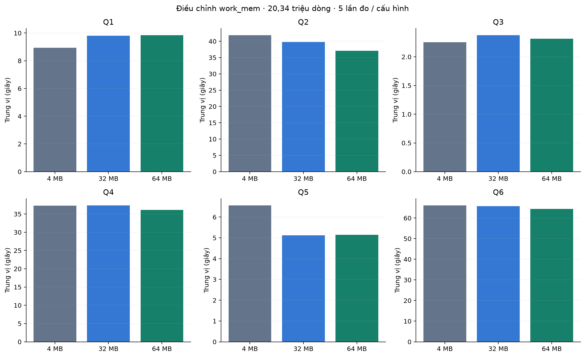
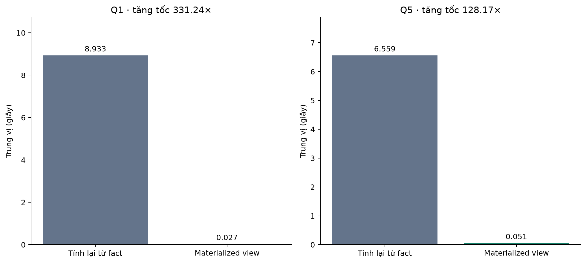
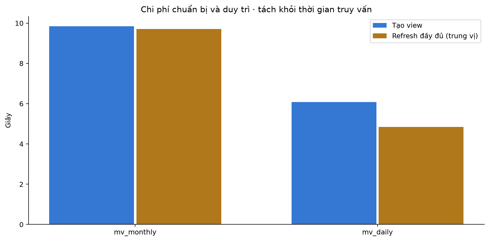

## Thực nghiệm PostgreSQL bổ sung: work_mem và materialized view

Nguồn là pg_extended_1110_132250, thu trong đợt Colab riêng với 720 phép đo trước. Đã xác minh đủ 400 lượt mới: 4 quy mô, 20 tổ hợp/mức, 5 lần/tổ hợp. Toàn bộ kết quả khớp baseline; 8 view qua 40 lượt refresh và đối chiếu sau refresh đều đạt. Tổng hồ sơ có 1.120 lượt đo chính qua hai đợt; không dùng baseline cũ làm mẫu số cho kết quả mới.

## Thiết kế đối chứng và phạm vi đo

Ba cấu hình PostgreSQL 4, 32, 64 MB dùng cùng nguồn và SQL Q1–Q6, max_parallel_workers_per_gather=2. Cấu hình materialized_4mb chỉ áp dụng Q1/Q5 và giữ work_mem=4 MB. Thời gian gồm kết nối, thiết lập phiên, truy vấn và nhận toàn bộ kết quả, không gồm ghi tệp/đối chiếu; baseline 4 MB được đo lại trong chính đợt bổ sung. Mỗi cấu hình có warm-up, thứ tự chạy xáo và trung vị 5 lần. Các view tạo từ snapshot nguồn, không đổi fact.

work_mem là giới hạn theo thao tác, có thể nhân lên theo worker và phép hash; không phải trần RAM server. Không có đo tổng bộ nhớ PostgreSQL để kết luận 64 MB là cấu hình tối ưu tài nguyên. EXPLAIN là lượt riêng có instrumentation, không thay cho trung vị chính.

## Kết quả work_mem trên toàn bộ dữ liệu

| Truy vấn | 4 MB (s) | 32 MB (s) | 64 MB (s) | 4 MB / 64 MB |
|---|---|---|---|---|
| Q1 | 8.933 | 9.806 | 9.839 | 0.908× |
| Q2 | 41.839 | 39.765 | 37.105 | 1.128× |
| Q3 | 2.252 | 2.375 | 2.314 | 0.973× |
| Q4 | 37.278 | 37.353 | 36.105 | 1.032× |
| Q5 | 6.559 | 5.120 | 5.141 | 1.276× |
| Q6 | 66.102 | 65.699 | 64.374 | 1.027× |

Q2 tăng tốc khoảng 1,13 lần ở 64 MB; Q5 khoảng 1,28 lần ở 32 MB. Q1 chậm hơn baseline, Q3 không cải thiện, Q4/Q6 chênh lệch nhỏ. Không có bằng chứng tăng work_mem luôn làm nhanh hơn; các chênh lệch nhỏ chưa được kiểm định ý nghĩa thống kê.

Q2: trong lượt EXPLAIN riêng, số block tạm ghi ở nút gốc giảm từ 264,042 xuống 118,342 khi tăng 4 → 64 MB; vẫn có 1 nút sắp xếp dùng đĩa. Số block ở gốc được dùng trực tiếp, không cộng các nút cha/con vì sẽ đếm trùng.

Q4: trong lượt EXPLAIN riêng, số block tạm ghi ở nút gốc giảm từ 194,411 xuống 64,725 khi tăng 4 → 64 MB; vẫn có 1 nút sắp xếp dùng đĩa. Số block ở gốc được dùng trực tiếp, không cộng các nút cha/con vì sẽ đếm trùng.

Q6: trong lượt EXPLAIN riêng, số block tạm ghi ở nút gốc giảm từ 443,173 xuống 290,034 khi tăng 4 → 64 MB; vẫn có 1 nút sắp xếp dùng đĩa. Số block ở gốc được dùng trực tiếp, không cộng các nút cha/con vì sẽ đếm trùng.

## Materialized view: tốc độ truy vấn và đánh đổi

| Truy vấn | Baseline mới (s) | Đọc view (s) | Tăng tốc |
|---|---|---|---|
| Q1 | 8.933 | 0.027 | 331.24× |
| Q5 | 6.559 | 0.051 | 128.17× |

| View | Số dòng | Tạo (s) | ANALYZE (s) | Refresh TB vị (s) | Dung lượng (KiB) |
|---|---|---|---|---|---|
| mv_monthly | 317 | 9.844 | 0.0030 | 9.709 | 16 |
| mv_daily | 9487 | 6.080 | 0.0061 | 4.848 | 512 |

Q1 nhanh khoảng 331,24 lần, Q5 khoảng 128,17 lần khi đọc tổng hợp đã lưu. mv_monthly có 317 dòng, mv_daily có 9.487 dòng thay vì quét 20.342.188 dòng fact. Chi phí là tạo, dung lượng, làm mới và nguy cơ dữ liệu cũ. Refresh ở đây tính lại đầy đủ trên nguồn không thay đổi; chưa đo concurrent refresh, cập nhật nguồn hay bảo trì gia tăng.

Với tỷ số trung vị quan sát, chi phí tạo riêng mv_monthly được bù sau khoảng 2 truy vấn Q1, mv_daily khoảng 1 truy vấn Q5. Đây chỉ là ước lượng ceil(create_time / saving_per_query), không bao gồm ANALYZE, refresh, lưu trữ hoặc tải đồng thời. Không cam kết hòa vốn tương tự trong vận hành thực tế.

## Kết luận bổ sung và khả năng tái lập

Hai kỹ thuật đã có mã, kết quả Colab và bằng chứng đối chiếu. work_mem phù hợp thử giảm I/O tạm nhưng cần đo theo truy vấn; materialized view phù hợp thống kê lặp lại trên snapshot hoặc có lịch refresh rõ. Để cập nhật kết quả, chạy src/14_analyze_postgres_extended.py trên ZIP gốc; CSV đã kiểm chứng dùng cho dashboard và report_blocks dùng cho báo cáo. Không cần xây lại EDA hay huấn luyện lại K-Means.